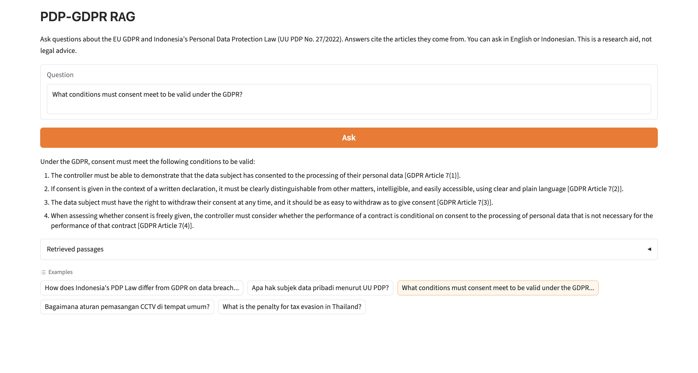
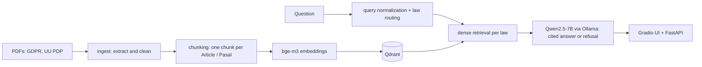

# PDP-GDPR RAG

A retrieval-augmented question-answering system over two data-protection laws: the EU **GDPR** (English) and Indonesia's **Personal Data Protection Law, UU PDP No. 27/2022** (Indonesian). Ask in English or Indonesian; answers cite the article they come from, and out-of-scope questions are refused instead of guessed.



> Research aid, not legal advice.

## Why this project

Most RAG demos run on clean, English, tutorial-sized corpora. This one works on real, messy material: an Indonesian statute distributed as a **scanned PDF with a broken OCR layer**, a second law in a different language, and questions that cross the language boundary (an English question answered from Indonesian text). The focus is on **measuring** the system rather than only building it: every design choice below is backed by an evaluation, including the ones that turned out not to help.

## How it works



| Stage | Choice |
|---|---|
| Chunking | One chunk per Article (GDPR, 99) / Pasal (UU PDP, 76); long articles split at 2,000 characters. 231 chunks, with law, language, article number and chapter as metadata |
| Embeddings | `BAAI/bge-m3` (multilingual, so English queries retrieve Indonesian articles) |
| Vector store | Qdrant, filtered by language so each law is searched separately |
| Query handling | The law's name is stripped from the query (it acts as noise), and a question that names exactly one law is routed to that law only |
| Generation | `qwen2.5:7b` through Ollama (local, no API key), instructed to answer only from the passages, cite every claim, and refuse otherwise |
| Serving | Gradio UI, FastAPI (`POST /api/ask`, `GET /health`), Docker Compose |

## Results

All numbers come from scripts in `eval/` and can be reproduced. `recall@5` counts a question as a hit if any gold article is in the top 5; MRR is the mean reciprocal rank of the first gold article.

### Retrieval

**Tuning set** (30 questions, used for failure analysis; the query-cleaning fix was designed on it, so treat these numbers as optimistic):

| Configuration (with query cleaning) | recall@5 | MRR |
|---|---|---|
| Dense only | 1.000 | 0.928 |
| Hybrid (dense + BM25, RRF) | 0.933 | 0.861 |
| Hybrid + reranker (`bge-reranker-v2-m3`) | 1.000 | 0.933 |

**Held-out set** (24 new, harder questions: indirect wording, Indonesian questions on GDPR, English questions on UU PDP; not used to tune anything):

| Configuration | recall@5 | MRR | latency / query |
|---|---|---|---|
| **Dense only (default)** | **1.000** | **0.917** | **~30 ms** |
| Hybrid (dense + BM25, RRF) | 0.750 | 0.616 | ~25 ms |
| Hybrid + reranker | 1.000 | 0.918 | ~1,850 ms |

One gold label was corrected after error analysis (a question about penalties for forging personal data is answered by Pasal 68, not only the prohibition in Pasal 66).

### Generation (24 held-out questions)

| Metric | Result |
|---|---|
| Citation validity (every cited article was among the retrieved passages) | 45 / 45 |
| Answer cites at least one gold article | 23 / 24 (the miss used a bare `[Article 82]` format that the checker does not parse) |
| In-scope questions wrongly refused | 0 / 24 |
| Out-of-scope questions refused (CCPA, Singapore PDPA, UU ITE, unrelated) | 6 / 6 |
| In-scope control questions answered | 3 / 3 |
| End-to-end time per answer (MacBook, local 7B model) | ~10.7 s |

## What the evaluation showed

- **Dense retrieval is enough here.** The cross-encoder reranker gives the same accuracy as dense search (MRR 0.918 vs 0.917) at roughly 70x the latency, and BM25 fusion hurt (recall 0.750). I kept dense retrieval as the default and left the other two as documented experiments.
- **BM25 seems to hurt most across languages.** A plausible cause is that an English query shares almost no tokens with Indonesian articles. This is a hypothesis; I did not test it in isolation.
- **A law's name in the question is noise.** English questions containing "Indonesia's PDP Law" pulled in generic articles that mention Indonesia or the law itself. Stripping the phrase before retrieval fixed these failures on the tuning set (tuned on that set, so optimistic). A second occurrence of the same problem ("menurut UU PDP") appeared in the UI and was fixed the same way, plus routing: a question naming one law now searches only that law.
- **Citation validity is not answer correctness.** All citations were valid, yet a manual read of 8 sampled answers found 4 with substantive problems: an incomplete list of GDPR principles, the same sub-paragraph letter reused for three different points, the prohibition article cited instead of the penalty article, and a muddled paraphrase of the CCTV rule. Retrieval is solid; answer quality is limited by the small local model.

## Limitations

- **List-style questions are not guaranteed complete.** "What are the data subject's rights?" retrieved Pasal 5-8 and 11-13 but missed 9 and 10 within the top 12. Expanding results to the whole chapter is a candidate fix I have not evaluated.
- **Sub-paragraph references (for example `16(e)`) and paraphrases from the 7B model should be verified against the article text.** The UI shows the retrieved passages for this reason.
- **Small evaluation sets** (30 and 24 questions): one question is worth 3-4 points, so small differences are noise.
- **The query-cleaning rules are regex-based** and cover specific phrasings; "the Indonesian law" is not handled.
- **OCR artifacts** remain in the UU PDP text (for example a stray apostrophe or a missing space), because the source PDF is a scan.
- Answers are written in English even for Indonesian questions (a deliberate choice for an English-speaking audience).
- Only two documents; no later amendments, implementing regulations or case law.

## Run it

**Prerequisites:** Docker Desktop, [Ollama](https://ollama.com) with `ollama pull qwen2.5:7b`, [uv](https://docs.astral.sh/uv/), Python 3.12.

```bash
git clone https://github.com/ReginaKirana/pdp-gdpr-rag.git
cd pdp-gdpr-rag
uv sync
```

**1. Get the source documents** (not included in the repo):
- GDPR (English PDF) from EUR-Lex, Regulation (EU) 2016/679, saved as `data/raw/gdpr_en.pdf`
- UU No. 27 Tahun 2022 from [peraturan.bpk.go.id](https://peraturan.bpk.go.id/Details/229798/uu-no-27-tahun-2022), saved as `data/raw/uu_pdp_id.pdf`

The BPK PDF is a scan with a poor embedded OCR layer (it loses five Pasal headings). Re-OCR it first:

```bash
brew install ocrmypdf tesseract-lang
ocrmypdf --force-ocr -l ind --deskew data/raw/uu_pdp_id.pdf data/raw/uu_pdp_id_ocr.pdf
mv data/raw/uu_pdp_id_ocr.pdf data/raw/uu_pdp_id.pdf
```

**2. Build the index:**

```bash
python -m src.ingest
python -m src.chunking          # expect: GDPR 99 Articles, UU PDP 76 Pasals, no warnings
docker compose up qdrant -d
python -m src.index
```

**3. Run the app** (Ollama must be running on the host):

```bash
docker compose up --build       # http://localhost:7860
# or, without Docker for the app:
python app.py
```

**4. Reproduce the evaluation:**

```bash
python -m eval.run_eval --file eval/questions.jsonl
python -m eval.run_eval --file eval/questions_heldout.jsonl --failures
python -m eval.run_refusal
python -m eval.run_citations
```

API example:

```bash
curl -X POST http://localhost:7860/api/ask -H "Content-Type: application/json" \
  -d '{"question": "What conditions must consent meet to be valid under the GDPR?"}'
```

## Project structure

```
src/        ingest.py, chunking.py, index.py, hybrid.py (retrieval), generate.py
eval/       questions*.jsonl, run_eval.py, run_refusal.py, run_citations.py
app.py      Gradio UI + FastAPI
Dockerfile, docker-compose.yml
```

## Possible next steps

Chapter-level expansion for list questions, answer-language matching, a larger local or hosted model for generation, citation checks at sub-paragraph level, and a third evaluation set to measure the query-cleaning rules on unseen phrasing.

## Tech

Python 3.12, sentence-transformers (`bge-m3`, `bge-reranker-v2-m3`), Qdrant, Ollama (Qwen2.5-7B), PyMuPDF, ocrmypdf/Tesseract, Gradio, FastAPI, Docker Compose, uv.
